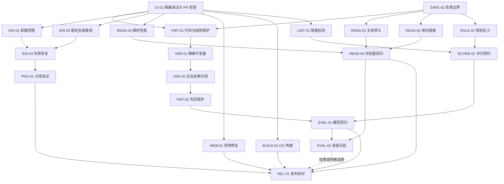

# adhd-md 可靠性改进路线图

先修复格式化与校验的完整性，再完善阅读、安装和评测。共 6 个里程碑、22 项任务；具体操作与验收见 [执行清单](docs/implementation-checklist.md)。

计划日期为 2026-10-13，审查基线为提交 `3c8b1fb`。实施已启动，逐项状态与验证证据记录在执行清单。

截至 2026-10-13，SAFE-01、FMT-01、VER-01、VER-02、FMT-02、INS-01、INS-02、INS-03、READ-01、READ-02、READ-03、PKG-01、WEB-01、BUILD-01、LINT-01、RULE-01、SCORE-01 已通过本机验收；READ-04 浏览器回归也已通过本机验收，最终关闭仍待 CI-01 托管工作流。卸载按软链目标或所有权标记判断，无法确认归属的目录会保留；HTML 文本显示、相对链接来源、无隐式资源读取、解析性能、安装更新、阅读器交互、规则覆盖和报告兼容都有回归。最新自测 199 项、完整 unittest 217 项、规则生成器测试 4 项通过；本机 npm tarball 含 38 个文件且包内 CLI 冒烟通过，规则表和单文件版同步检查、官网构建与 `git diff --check` 通过。已补充 Unreleased 变更记录、调用方迁移说明和当前宿主 / 工具版本快照。GitHub 托管矩阵、最低 Node 22.12.0 官网构建、托管 npm job 与失败注入仍待完成；EVAL-01、需要真实自愿参与者的 EVAL-02 和 REL-01 也未完成。

## 当前执行顺序

1. 完成本机 GitHub 设备登录并恢复仓库写权限后创建草稿 PR，再运行 CI-01：检查 Python 3.9 / 3.14 × macOS / Linux 矩阵、Node 18 CLI、Node 22.12.0 官网构建和真实 npm tarball；再注入测试失败与单文件版漂移，确认 PR 检查变红且不会触发 Pages 发布。
2. 托管检查和失败注入通过后关闭 CI-01，再补齐 READ-04 与 PKG-01 的托管证据。
3. 准备 EVAL-01 的冻结语料与宿主记录；EVAL-02 方案可先准备，招募和结果验收需真实参与者及明确同意。用户于 2026-10-13 表示暂时无法安排参与者，因此 EVAL-02 保持未完成。完成后再核对 REL-01 候选发布材料。

下面保留路线图编制时的初始启动顺序，供回看任务安排依据。

## 初稿的启动顺序

1. 建立隔离测试与 PR 检查，完成 `CI-01`，让后续修复在合入前得到验证。
2. 明确校验与写回边界，完成 `SAFE-01`，同步修正超出实测能力的说明。
3. 并行处理 `FMT-01`、`INS-01`，提前准备 `VER-01` 样例。`FMT-01` 验收后完成 `VER-01`，消除破坏原文和卸载越界的风险。

预期得到可复现的失败样例、独立验收依据和首批修复 PR。每个 PR 都应展示修复前后的行为差异。

- [当前基线与目标](#当前基线与目标)
- [里程碑和投入估算](#里程碑和投入估算)
- [依赖与并行安排](#依赖与并行安排)
- [任务归属和 PR 拆分](#任务归属和-pr-拆分)
- [验收和发布条件](#验收和发布条件)
- [需要在实施时确定的决策](#需要在实施时确定的决策)
- [范围和维护方式](#范围和维护方式)

## 当前基线与目标

基线已通过 155 项 `selftest`、单文件同步检查和官网构建。额外边界复现确认了格式化破坏缩进、校验漏检、项目卸载越界等问题。测试数量用来记录起点，不作为质量目标。

| 当前证据 | 对应任务 | 达成后的行为 |
|---|---|---|
| CJK 空格处理破坏缩进代码 | FMT-01、FMT-02 | 保护代码与结构空白 |
| 链接变更、句内换序被放行 | VER-01、VER-02 | 可靠识别越界修改 |
| 项目卸载删除用户级 prompt | INS-01 | 删除限定在选定范围 |
| HTML 字符被当成 Markdown | READ-01、READ-02 | 显示和导出保留信息 |
| 未闭合括号导致平方级耗时 | READ-03、READ-04 | 解析耗时受控且可回归 |
| PR 与包内容检查不足 | CI-01、PKG-01 | 合入和分发前都有检查 |

校验成功只表示通过已声明的机器检查。一般自然语言的语义等价仍需人工判断，原有条件、例外、单位和指代关系都要复核。

新测试必须验证用户实际得到的内容。原始文本藏在阅读页数据中，不能替代可见内容正确；词频一致也不能替代词序和链接正确。

## 里程碑和投入估算

按一位熟悉仓库的全职维护者估算，共需 **19–32 开发人日**，约 4–7 个工作周。包含实现、测试和文档修订；不含招募、外部评审等待和扩大研究样本的投入。

这些区间用于安排任务，尚未形成交付日期。M0 结束后重估 M1，特别检查合法重排的识别复杂度。

| 里程碑 | 目标 | 任务数 | 开发人日 | 默认顺序 |
|---|---|---|---|---|
| M0 | 建立检查和边界 | 2 | 1–2 | 最先开始 |
| M1 | 保护原文和安装范围 | 5 | 6–10 | M0 之后 |
| M2 | 修复提取和阅读 | 4 | 3–5 | M1 主线之后 |
| M3 | 完善分发和官网 | 5 | 3–5 | 可与 M1、M2 并行 |
| M4 | 统一规则和评分 | 3 | 3–5 | 安全修复之后 |
| M5 | 建立评测和发布记录 | 3 | 3–5 | 功能稳定之后 |

### M0 建立隔离测试和检查边界

任务为 `CI-01`、`SAFE-01`。先把 PR 检查与 Pages 部署拆开，建立安装测试夹具，再写清支持的 Markdown 结构、合法格式变换和不确定结果的处理。

完成条件是普通 PR 会触发检查；测试不访问真实用户安装目录；机器检查的范围有明确说明。

已有缺陷按任务建立回归样例，修复 PR 必须通过这些样例。

### M1 保护原文和安装范围

任务为 `FMT-01`、`VER-01`、`VER-02`、`FMT-02`、`INS-01`。先修解析与不变量检查，再把可靠检查接入写回流程；卸载范围修复可独立交付。

完成条件是已复现的代码、链接、权限元数据和句内换序问题全部被阻止。合法拆段、列表化、整块搬移、加反引号、目录和折叠仍有正向测试。

出现校验失败或无法判断时，原文件必须保持不变。不得用旧版 `verify` 通过作为唯一验收依据。

### M2 保证提取稿和阅读显示准确

任务为 `READ-01` 至 `READ-04`。同时检查 HTML 提取稿、阅读页可见内容、分段 source、下载原文和来源定位。

完成条件是公式符号与本地相对链接可找回，异常输入不再重复回扫，阅读进度、键盘操作和全文打印有浏览器回归。已有脚本隔离、危险链接禁用和图片不自动加载的行为继续保持。

### M3 让安装和官网可重复使用

任务为 `INS-02`、`INS-03`、`PKG-01`、`WEB-01`、`BUILD-01`。三条安装路径继续共用同一脚本，处理稳定路径、失败恢复、包内容和官网已知问题。

完成条件是清理下载目录后安装仍可用，升级失败有旧版可恢复，实际分发包能独立运行。官网移动端可切换语言，英文资源可访问，OG 构建不依赖作者个人路径。

### M4 统一规则和评分表达

任务为 `LINT-01`、`RULE-01`、`SCORE-01`。修复链接检测后，将规则元数据集中管理，再统一各档位过滤、文本报告与 JSON 输出。

完成条件是规则定义、扣分表和生成文档一致，`light` 不误执行仅高档位生效的规则。报告区分脚本分、未评分项、警告和硬失败，现有调用方获得迁移说明。

### M5 建立独立评测和发布记录

任务为 `EVAL-01`、`EVAL-02`、`REL-01`。模型回归与读者试验分开记录，避免把脚本分上升直接当成理解效果提升。

完成条件是独立语料有可重跑的结果，发布包与支持矩阵有证据。读者试验若尚未完成，记录延期和结论边界；正确性修复可以发布，阅读效果宣称继续等待实测。

## 依赖与并行安排

图中箭头表示验收依赖。各任务的样例、测试夹具与草案可提前准备，不必等待前项实现后才开始阅读代码。

若有多位维护者，可分成核心、阅读、分发、规则与文档四条工作线。`adhd_md.py` 同时涉及格式化、校验和 lint，相关改动应顺序合入，避免并行大改同一解析器。

## 任务归属和 PR 拆分

每项指定一位负责合入的人，并安排一位复核验收结果的人。当前只划分责任领域，认领时再填写姓名。

| 领域 | 负责事项 | 复核重点 |
|---|---|---|
| 核心 | FMT、VER、LINT | 原文与程序语义保护 |
| 阅读 | READ | 可见内容与来源一致 |
| 分发 | CI、INS、PKG、BUILD | 安装隔离与失败恢复 |
| 规则与文档 | SAFE、RULE、SCORE、EVAL、WEB、REL | 行为与说明一致 |

默认一项任务一个可审阅 PR。单项同时改解析、报告和用户文案时，可以拆分，但所有验收项通过后才关闭任务。

建议首批 PR 顺序为 `CI-01`、`SAFE-01`、`INS-01`、`FMT-01`、`VER-01`。`READ-01` 和官网修复可在另一条工作线上推进。

需要一起合入的内容包括 HTML 转义与阅读器解码、规则定义与生成表格、输出协议与迁移文档。避免让中间版本出现一半实现新约定、一半沿用旧约定的情况。

## 验收和发布条件

只勾选已经实现、验证并留下证据的项目。证据至少包含复现输入、预期结果、测试命令、环境与结果；链接到对应提交或 PR。

| 检查对象 | 验收条件 | 独立证据 |
|---|---|---|
| 格式化 | 代码及结构保护成立 | 预期文件、语法树、字符串值 |
| 校验 | 已知反例被拒绝 | 明确标注的正反例 |
| 阅读 | 显示、导出和来源一致 | 浏览器文本与下载文件 |
| 安装 | 操作不越界，失败可恢复 | 隔离目录快照和故障注入 |
| 规则评分 | 数据一致、边界准确 | 独立手算样例和生成检查 |
| 分发 | 包内运行不依赖源码仓库 | 实际 tarball 的冒烟测试 |

所有仓库修改均运行 `selftest` 与 `build_standalone.py --check`。改到指定生成源时先重建单文件版；改官网时加跑构建。

完整命令见 [清单的检查入口](docs/implementation-checklist.md#检查入口)。

M1 完成后可准备正确性修复的小版本候选，无需等待读者招募。发行说明需列出仍未关闭的阅读与分发问题，且不能扩展无损或效果承诺。

完整路线图完成以 22 项任务全部关闭为准。若将 `EVAL-02` 延期，发布记录可通过，路线图仍保留该待办。

## 需要在实施时确定的决策

`SAFE-01` 确定格式变换白名单与不支持语法的处理。优先选择保留原样或停止写回，不能静默降级后报校验成功。

`VER-01` 明确数字、单位和 frontmatter 的保护方式。建议对声明为不变量的值采用精确比对；允许的归一化要逐项列出并配正反例。

`INS-02` 确定项目级 canonical 路径。选择需要覆盖既有安装升级、无宿主场景和三条安装入口，不能只修成功提示中的一个字符串。

`RULE-01` 确定结构化规则文件格式及生成边界。运行时继续只用 Python 标准库，测试工具可另列开发依赖。迁移先保持既有语义，阈值调整另行评审。

`SCORE-01` 确定 scope 对显示、扣分和覆盖率的影响。保持 JSON 字段兼容；必须破坏兼容时记录版本变化和调用方迁移方式。

`READ-03` 在固定环境校准性能预算。增长率与绝对耗时共同判断，避免把某台开发机的测量直接当成所有 CI 的门槛。

## 范围和维护方式

本轮覆盖已复现的正确性问题、分发可靠性、规则一致性和评测基础设施。现有阅读、提取、跨宿主能力继续维护。

新增云端服务、账户同步、移动应用、TTS、更多文档格式和大规模重构留待后续需求评估。当前阶段先积累语法测试，再决定是否合并两套解析器。

每完成一个里程碑，更新实际投入、剩余风险与下一阶段估算。发现新问题时补任务 ID、复现和优先级，保留原任务的验收证据。

准备实施时，从 [CI-01](docs/implementation-checklist.md#ci-01-建立隔离测试和-pr-检查) 开始认领。任务执行、阶段验收和发布核对都在同一份清单中记录。
